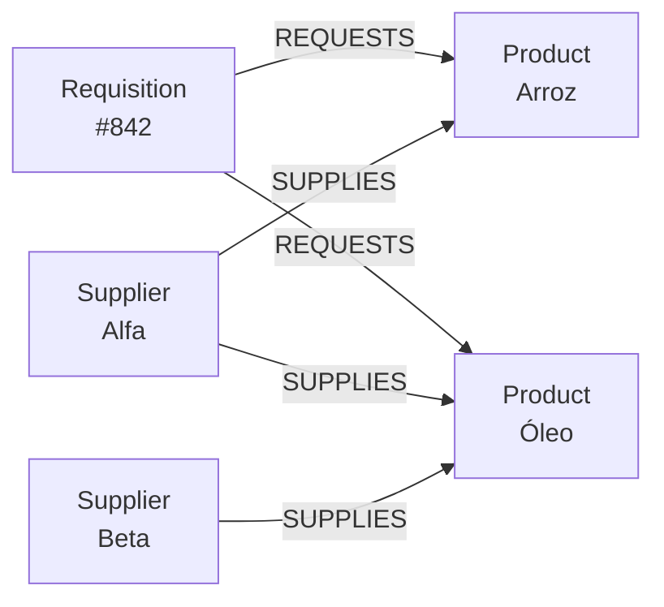
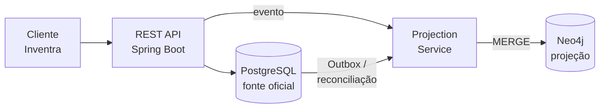

# Neo4j no Inventra: cobertura inteligente de fornecedores

> Arquitetura de dados • BD2-06 + Traversal
> Documento de arquitetura proposto • 14 de outubro de 2026 • Baseado no código atual do Inventra e na identidade visual fornecida.
> Fonte: [`Inventra_Neo4j_Cobertura_Fornecedores.pdf`](Inventra_Neo4j_Cobertura_Fornecedores.pdf) (16 páginas). Este arquivo transcreve o conteúdo completo do PDF; os scripts Cypher estão também em [`constraints/`](../constraints/constraints.cypher), [`indexes/`](../indexes/indexes.cypher), [`queries/`](../queries) e [`seeds/`](../seeds/seed_cobertura.cypher).

Especificação técnica de uma projeção de grafo aplicada a uma única decisão operacional: descobrir quais fornecedores conseguem atender os produtos de uma requisição, com quais lacunas, custo de referência e prazo máximo.

| | |
|---|---|
| **Recorte funcional** | Requisições → itens → produtos → fornecedores |
| **Status do documento** | Proposta implementável; Neo4j não executado neste ambiente. |
| **Card** | [INV2-27](https://inventraoficial.atlassian.net/browse/INV2-27) — modelar entidades como grafo no Neo4j (ver [aderência ao card](#17-aderência-ao-card-inv2-27)) |
| **Validação posterior** | Constraints, índices, seed e a consulta corrigida foram executados num Neo4j 5 descartável (Docker) ao versionar este material; ver a [seção 16](#16-pontos-de-atenção-na-transcrição). |

Gestão • Estoque • Controle • Organização • Inovação • Tecnologia

## Sumário

1. [Resumo executivo](#01-resumo-executivo)
2. [Onde isso entra no Inventra real](#02-onde-isso-entra-no-inventra-real)
3. [Aplicação na jornada da requisição](#03-aplicação-na-jornada-da-requisição)
4. [Modelo de grafo mínimo](#04-modelo-de-grafo-mínimo)
5. [Schema, restrições e projeção](#05-schema-restrições-e-projeção)
6. [Arquitetura e sincronização](#06-arquitetura-e-sincronização)
7. [Traversal principal em Cypher](#07-traversal-principal-em-cypher)
8. [Contrato REST](#08-contrato-rest)
9. [Implementação Java/Spring proposta](#09-implementação-javaspring-proposta)
10. [Repositório de traversal e DTO](#10-repositório-de-traversal-e-dto)
11. [Massa de teste e resultado esperado](#11-massa-de-teste-e-resultado-esperado)
12. [Estratégia de testes](#12-estratégia-de-testes)
13. [DevOps, implantação e observabilidade](#13-devops-implantação-e-observabilidade)
14. [Por que Neo4j e não somente SQL](#14-por-que-neo4j-e-não-somente-sql)
15. [Riscos, critérios de aceite e entrega](#15-riscos-critérios-de-aceite-e-entrega)
16. [Pontos de atenção na transcrição](#16-pontos-de-atenção-na-transcrição)
17. [Aderência ao card INV2-27](#17-aderência-ao-card-inv2-27)

---

## 01 Resumo executivo

> **Decisão proposta**
> Adicionar ao módulo de requisições uma análise de cobertura de fornecedores. Dada uma requisição, o serviço percorre os produtos pedidos e todos os fornecedores vinculados a eles, ranqueando quem cobre mais itens e expondo o que cada fornecedor não atende.

**Por que é um diferencial real.** Em vez de obrigar o usuário a escolher um fornecedor antes de receber inteligência, o Inventra apresenta as opções possíveis para o conjunto inteiro da requisição — inclusive quando nenhum fornecedor cobre tudo.

**Por que o recorte é pequeno.** O grafo contém somente `Requisition`, `Product` e `Supplier`, com dois relacionamentos. Não substitui estoque, autenticação, aprovações, compras ou o banco relacional.

**Pergunta de negócio**

> "Para esta requisição, quais fornecedores conseguem atender o maior número de produtos, quais itens cada um deixa descobertos e qual é a estimativa de custo e prazo da parte coberta?"

| Aspecto | Decisão |
|---|---|
| Fonte de verdade | PostgreSQL continua responsável pelas entidades e transações. |
| Papel do Neo4j | Projeção de leitura reconstruível para traversal e agregação por conectividade. |
| Entrada | `requisitionId` obtido pela rota REST e `kitchenId` validado pelo usuário autenticado. |
| Saída | ranking, cobertura %, itens cobertos, lacunas, custo coberto, maior lead time e rating. |
| Consistência | Eventual; reconciliação periódica corrige eventos atrasados ou duplicados. |
| Falha aceitável | Endpoint responde indisponibilidade específica; fluxo transacional segue no PostgreSQL. |

**Leitura rápida do fluxo**

1. usuário abre uma requisição em análise →
2. API valida a cozinha →
3. Neo4j percorre `REQUESTS` e `SUPPLIES` →
4. serviço calcula e ordena cobertura →
5. interface mostra fornecedores e lacunas →
6. usuário ainda decide qual fornecedor sugerir; nenhuma compra é criada automaticamente.

---

## 02 Onde isso entra no Inventra real

A proposta nasce de um ponto específico já presente no código. Ela não pressupõe um novo módulo amplo; amplia a decisão dentro de `Requisition` e reutiliza vínculos já mantidos em `ProductSupplier`.

| Evidência encontrada | Comportamento atual | Oportunidade do grafo |
|---|---|---|
| `RequisitionItem` | Liga requisição a produto; aceita `suggestedSupplier`, `quantity`, `estimatedPrice` e `note`. | O nó `Requisition` e `REQUESTS` preservam a demanda a analisar. |
| `ProductSupplier` | Liga produto a fornecedor com `supplierCode`, `referencePrice` e `leadTimeDays`. | `SUPPLIES` transforma cada vínculo em uma aresta rica para comparação. |
| `RequisitionService.addItem` | Fornecedor sugerido é opcional, mas a referência de preço só é buscada quando o ID já foi enviado. | A análise antecede a escolha e descobre todos os candidatos conectados. |
| `KitchenAccessGuard` | Usuário só acessa a cozinha do próprio cadastro. | A requisição é validada no PostgreSQL antes de consultar o grafo. |
| Redis | Já existe como infraestrutura para fila/concorrência de registro de produto. | Não é substituído: Redis coordena fluxo; Neo4j responde conectividade. |

| Antes | Depois |
|---|---|
| O solicitante informa um fornecedor ou deixa o campo vazio. A API não apresenta uma visão conjunta da requisição, nem identifica automaticamente produtos sem alternativa de fornecimento. | Um botão "Analisar fornecedores" retorna um ranking explicável. O usuário enxerga cobertura total/parcial, prazo e custo de referência antes de selecionar ou dividir a compra. |

> **Limite funcional deliberado**
> O endpoint não altera `suggestedSupplierId`, `estimatedPrice`, status da requisição ou estoque. Ele é somente leitura e serve à decisão humana. A gravação continua nas rotas existentes, preservando regras, auditoria e procedures do PostgreSQL.

**Hipótese de valor a validar.** Reduzir o tempo de comparação manual e revelar requisições inviáveis mais cedo. Métricas sugeridas:

- tempo entre inclusão do último item e escolha do fornecedor;
- percentual de requisições com cobertura total;
- quantidade média de fornecedores avaliados;
- incidência de itens sem fornecedor cadastrado.

---

## 03 Aplicação na jornada da requisição

O ponto ideal é a tela de detalhes de uma requisição com status `UNDER_REVIEW`, imediatamente após os itens serem adicionados e antes da aprovação.

| Etapa | Ação do usuário | Resposta do Inventra |
|---|---|---|
| 1. Montagem | Inclui arroz, óleo, feijão e leite na requisição. | PostgreSQL salva `RequisitionItem`; projeção recebe ou reconcilia `REQUESTS`. |
| 2. Análise | Seleciona "Analisar fornecedores". | API verifica JWT, carrega a requisição e executa `KitchenAccessGuard`. |
| 3. Traversal | Nenhuma escolha prévia de fornecedor é exigida. | Neo4j navega requisição → produtos ← fornecedores e agrega por fornecedor. |
| 4. Decisão | Compara "Alfa: 75% / 3 itens" e "Beta: 50% / 2 itens". | Interface lista itens cobertos, lacunas, custo estimado e maior prazo. |
| 5. Ação | Escolhe um fornecedor por item ou decide fracionar. | Rotas atuais persistem `suggestedSupplierId` e `estimatedPrice`. |

### Estados de interface recomendados

- **Cobertura total.** Selo verde "Atende 4 de 4". Mostrar prazo máximo e custo total de referência; oferecer ação para aplicar a sugestão item a item, sujeita a confirmação.
- **Cobertura parcial.** Selo amarelo "Atende 3 de 4". Destacar produto sem cobertura e manter visíveis fornecedores complementares.
- **Sem vínculo cadastrado.** Mensagem objetiva: "Nenhum fornecedor está associado ao produto Leite integral". Direcionar ao cadastro Product ↔ Supplier já existente.
- **Projeção indisponível.** Não bloquear criação, submissão ou aprovação. Exibir "Análise temporariamente indisponível" e permitir repetir.

> **Regra de explicabilidade**
> Cada posição do ranking deve ser auditável: cobertura é itens distintos cobertos ÷ itens distintos solicitados; prazo é o maior `leadTimeDays` entre os itens cobertos; custo usa `referencePrice × quantity` apenas onde há preço; `rating` vem de `Supplier`. Nenhum "score mágico" deve ocultar esses componentes.

---

## 04 Modelo de grafo mínimo

Traversal de cobertura: requisição → produtos ← fornecedores



*Figura redesenhada a partir da ilustração do PDF (a original é um desenho; os vínculos aqui seguem a matriz da seção 11).*

O percurso possui dois níveis de relacionamento e cruza uma aresta de demanda com uma aresta de capacidade de fornecimento. A direção desenhada expressa semântica; o Cypher pode atravessar `SUPPLIES` no sentido inverso.

| Elemento | Chave | Propriedades projetadas | Origem relacional |
|---|---|---|---|
| `:Requisition` | `id` | `kitchenId`, `type`, `status`, `createdAt`, `updatedAt` | `tb_requisition` |
| `:Product` | `id` | `name`, `active` | `tb_product` |
| `:Supplier` | `id` | `legalName`, `rating`, `active` | `tb_supplier` |
| `:REQUESTS` | `itemId` | `quantity`, `estimatedPrice`, `note`, `updatedAt` | `tb_requisition_item` |
| `:SUPPLIES` | `productId` + `supplierId` | `supplierCode`, `referencePrice`, `leadTimeDays`, `updatedAt` | `tb_product_supplier` |

### Decisões de modelagem

- **`RequisitionItem` vira relacionamento:** sua razão de existir é qualificar o vínculo entre uma requisição e um produto; `itemId` permanece como identificador da aresta.
- **`ProductSupplier` vira relacionamento:** preço e prazo pertencem à capacidade de um fornecedor atender um produto, não aos nós isoladamente.
- **`Kitchen` não vira nó nesta primeira versão:** `kitchenId` na requisição basta para filtro defensivo; incluir `Kitchen` ampliaria o escopo sem melhorar o traversal principal.
- **Categoria e estoque ficam fora:** não são necessários para responder a pergunta escolhida. Essa exclusão mantém a projeção pequena e coerente.
- **IDs do PostgreSQL são preservados:** permitem `MERGE` idempotente e rastreabilidade cruzada.

---

## 05 Schema, restrições e projeção

As constraints evitam duplicidade de nós; índices apoiam a entrada por requisição/cozinha. A unicidade dos relacionamentos é garantida pelo padrão de `MERGE` com as chaves relacionais.

Arquivos: [`constraints/constraints.cypher`](../constraints/constraints.cypher) e [`indexes/indexes.cypher`](../indexes/indexes.cypher)

```cypher
CREATE CONSTRAINT requisition_id IF NOT EXISTS
FOR (r:Requisition) REQUIRE r.id IS UNIQUE;

CREATE CONSTRAINT product_id IF NOT EXISTS
FOR (p:Product) REQUIRE p.id IS UNIQUE;

CREATE CONSTRAINT supplier_id IF NOT EXISTS
FOR (s:Supplier) REQUIRE s.id IS UNIQUE;

CREATE INDEX requisition_kitchen IF NOT EXISTS
FOR (r:Requisition) ON (r.kitchenId);

CREATE INDEX supplier_active IF NOT EXISTS
FOR (s:Supplier) ON (s.active);
```

### Upsert de uma requisição e seus itens

Arquivo: [`queries/upsert_requisicao.cypher`](../queries/upsert_requisicao.cypher)

```cypher
MERGE (r:Requisition {id: $requisition.id})
SET r.kitchenId = $requisition.kitchenId,
    r.type = $requisition.type,
    r.status = $requisition.status,
    r.updatedAt = datetime();

UNWIND $items AS item
MERGE (p:Product {id: item.productId})
SET p.name = item.productName, p.active = item.productActive
MERGE (r)-[rel:REQUESTS {itemId: item.itemId}]->(p)
SET rel.quantity = item.quantity,
    rel.estimatedPrice = item.estimatedPrice,
    rel.note = item.note,
    rel.updatedAt = datetime();
```

### Upsert do catálogo de fornecimento

Arquivo: [`queries/upsert_catalogo_fornecimento.cypher`](../queries/upsert_catalogo_fornecimento.cypher)

```cypher
MERGE (s:Supplier {id: $supplierId})
SET s.legalName = $legalName, s.rating = $rating, s.active = $active
MERGE (p:Product {id: $productId})
MERGE (s)-[rel:SUPPLIES]->(p)
SET rel.supplierCode = $supplierCode,
    rel.referencePrice = $referencePrice,
    rel.leadTimeDays = $leadTimeDays,
    rel.updatedAt = datetime();
```

> **Remoções também são eventos**
> Ao excluir `RequisitionItem` ou desvincular `ProductSupplier`, a projeção deve apagar a aresta correspondente. Desativar produto/fornecedor atualiza `active`; exclusão física do nó só ocorre quando a política relacional realmente o remover.

---

## 06 Arquitetura e sincronização



*Figura redesenhada a partir da ilustração do PDF. Legenda original: "Falha no Neo4j não desfaz a transação de negócio; a projeção é reprocessável."*

A integração recomendada é assíncrona. A transação de negócio confirma primeiro no PostgreSQL; depois um evento projeta a mudança no Neo4j. Isso evita que uma indisponibilidade do grafo impeça a operação principal.

| Mecanismo | Responsabilidade | Detalhe operacional |
|---|---|---|
| Outbox no PostgreSQL | Registrar evento na mesma transação da alteração. | Tipos: `REQUISITION_UPSERTED`, `ITEM_UPSERTED/DELETED`, `PRODUCT_SUPPLIER_UPSERTED/DELETED`, `SUPPLIER_UPDATED`. |
| Projection worker | Ler eventos, montar parâmetros e executar `MERGE`/`DELETE` no Neo4j. | Idempotente por `aggregateId + eventId`; retry com backoff; dead letter após limite. |
| Reconciliação | Comparar contagens e `updatedAt`; recompor entidades divergentes. | Job noturno e endpoint administrativo protegido para uma requisição. |
| Watermark | Expor idade da projeção na resposta. | `projectionUpdatedAt` e `stale=true` quando exceder, por exemplo, 5 minutos. |
| Redis existente | Pode acordar/serializar o worker, se o padrão do projeto for reaproveitado. | Não armazena o grafo e não se torna fonte de verdade. |

### Consistência e atomicidade

- O endpoint consulta o PostgreSQL primeiro para validar existência, cozinha e autorização; depois usa `id + kitchenId` no Cypher.
- Se a projeção estiver atrasada, a resposta inclui `stale` e timestamp — não retorna um ranking silenciosamente desatualizado.
- Eventos duplicados são seguros porque os comandos usam `MERGE` e `SET`; eventos fora de ordem usam `version`/`updatedAt` para impedir regressão.
- Uma reconstrução completa apaga apenas o banco/projeção Neo4j controlado e reprojeta tabelas relacionais; nunca apaga o PostgreSQL.

---

## 07 Traversal principal em Cypher

A consulta entra pela requisição autorizada, materializa sua demanda, encontra fornecedores conectados a pelo menos um produto e calcula cobertura e lacunas por fornecedor.

Arquivo: [`queries/cobertura_fornecedores.cypher`](../queries/cobertura_fornecedores.cypher) — transcrito literalmente do PDF e **rejeitado pelo Neo4j 5** (ver [pontos de atenção](#16-pontos-de-atenção-na-transcrição)). A versão executável está em [`queries/cobertura_fornecedores_validada.cypher`](../queries/cobertura_fornecedores_validada.cypher).

```cypher
MATCH (r:Requisition {id: $requisitionId, kitchenId: $kitchenId})
MATCH (r)-[req:REQUESTS]->(p:Product)
WITH r,
     collect({product: p, request: req}) AS demand,
     count(DISTINCT p) AS totalProducts

UNWIND demand AS d
MATCH (s:Supplier)-[sp:SUPPLIES]->(d.product)
WHERE s.active = true AND d.product.active = true

WITH r, demand, totalProducts, s,
     collect(DISTINCT {
        id: d.product.id,
        name: d.product.name,
        quantity: d.request.quantity,
        referencePrice: sp.referencePrice,
        leadTimeDays: sp.leadTimeDays
     }) AS covered,
     max(sp.leadTimeDays) AS maxLeadTimeDays

WITH r, totalProducts, s, covered, maxLeadTimeDays,
     [d IN demand
      WHERE NOT d.product.id IN [c IN covered | c.id]
      | {id: d.product.id, name: d.product.name}] AS uncovered,
     reduce(cost = 0.0, c IN covered |
        cost + coalesce(c.referencePrice, 0) * c.quantity
     ) AS estimatedCoveredCost

RETURN s.id AS supplierId,
       s.legalName AS supplierName,
       s.rating AS rating,
       size(covered) AS coveredCount,
       totalProducts,
       round(100.0 * size(covered) / totalProducts, 1) AS coveragePercent,
       covered, uncovered, estimatedCoveredCost, maxLeadTimeDays

ORDER BY coveragePercent DESC,
         maxLeadTimeDays ASC,
         rating DESC,
         estimatedCoveredCost ASC,
         supplierName ASC;
```

> **Traversal real:** o resultado não é obtido por busca de um nó isolado. A consulta atravessa `REQUESTS` para descobrir o conjunto dinâmico de produtos e, para cada produto, atravessa `SUPPLIES` no sentido inverso para descobrir e agrupar candidatos.

---

## 08 Contrato REST

> `GET /api/requisitions/{id}/supplier-coverage`
> Endpoint autenticado e somente leitura. O `kitchenId` não vem do cliente: é obtido da requisição carregada no PostgreSQL e validado com `KitchenAccessGuard`.

### Resposta 200 — exemplo não trivial

```json
{
  "requisitionId": 842,
  "kitchenId": 12,
  "totalProducts": 4,
  "projectionUpdatedAt": "2026-10-14T11:40:12-03:00",
  "stale": false,
  "suppliers": [
    {
      "supplierId": 31,
      "supplierName": "Distribuidora Alfa",
      "rating": 5,
      "coveredCount": 3,
      "coveragePercent": 75.0,
      "estimatedCoveredCost": 486.50,
      "maxLeadTimeDays": 3,
      "coveredProducts": [
        {"productId": 10, "name": "Arroz", "quantity": 20,
         "referencePrice": 18.50, "leadTimeDays": 2},
        {"productId": 11, "name": "Óleo", "quantity": 10,
         "referencePrice": 7.65, "leadTimeDays": 3},
        {"productId": 12, "name": "Feijão", "quantity": 5,
         "referencePrice": 8.00, "leadTimeDays": 2}
      ],
      "uncoveredProducts": [{"productId": 13, "name": "Leite"}]
    }
  ]
}
```

### Respostas de erro

| HTTP | Quando | Formato esperado |
|---|---|---|
| 401 | JWT ausente/inválido | Problem Details já adotado pelo projeto. |
| 403 | Usuário não pertence à cozinha da requisição | `title=Forbidden`; `detail` da `KitchenAccessGuard`. |
| 404 | Requisição não existe | `ResourceNotFoundException` → Problem Details. |
| 409 | Projeção ainda não contém a requisição e política decide não degradar | `type=/problems/graph-projection-not-ready`. |
| 503 | Driver Neo4j indisponível/timeout | `type=/problems/supplier-coverage-unavailable`; `retryable=true`. |

---

## 09 Implementação Java/Spring proposta

Estrutura mínima, sem converter todo o domínio JPA para Spring Data Neo4j:

```text
core/service/requisition/coverage/
    SupplierCoverageUseCase.java
    SupplierCoverageService.java
    model/SupplierCoverageResponse.java

infrastructure/graph/
    Neo4jSupplierCoverageRepository.java
    Neo4jProjectionWriter.java
    GraphProjectionHealthIndicator.java

infrastructure/controller/
    RequisitionController.java   // novo GET /{id}/supplier-coverage
```

### Dependência e configuração

```xml
<dependency>
    <groupId>org.springframework.boot</groupId>
    <artifactId>spring-boot-starter-data-neo4j</artifactId>
</dependency>
```

```properties
spring.neo4j.uri=${NEO4J_URI:bolt://localhost:7687}
spring.neo4j.authentication.username=${NEO4J_USERNAME:neo4j}
spring.neo4j.authentication.password=${NEO4J_PASSWORD}
app.neo4j.supplier-coverage.enabled=${NEO4J_COVERAGE_ENABLED:false}
app.neo4j.supplier-coverage.timeout=${NEO4J_COVERAGE_TIMEOUT:2s}
```

### Controller e serviço

```java
@GetMapping("/{id}/supplier-coverage")
public ResponseEntity<SupplierCoverageResponse> supplierCoverage(
        @PathVariable Integer id) {
    return ResponseEntity.ok(coverageUseCase.analyze(id));
}

@Service
@RequiredArgsConstructor
class SupplierCoverageService implements SupplierCoverageUseCase {

    private final RequisitionRepository requisitions;
    private final KitchenAccessGuard accessGuard;
    private final SupplierCoverageGraphRepository graph;

    public SupplierCoverageResponse analyze(Integer id) {
        Requisition req = requisitions.findById(id)
            .orElseThrow(() -> new ResourceNotFoundException(
                "Requisição não encontrada."));
        Integer kitchenId = req.getKitchen().getId();
        accessGuard.assertAccess(kitchenId);
        return graph.findCoverage(id, kitchenId);
    }
}
```

**Preferência:** usar `Neo4jClient` com parâmetros, pois o retorno é uma projeção agregada e não uma árvore de entidades. `@Query` em repository também é válido, mas tende a acoplar o DTO à infraestrutura.

---

## 10 Repositório de traversal e DTO

```java
@Repository
@RequiredArgsConstructor
class Neo4jSupplierCoverageRepository
        implements SupplierCoverageGraphRepository {

    private final Neo4jClient neo4j;

    public SupplierCoverageResponse findCoverage(Integer requisitionId,
                                                 Integer kitchenId) {
        List<SupplierCoverage> suppliers = neo4j.query(CYPHER)
            .bind(requisitionId).to("requisitionId")
            .bind(kitchenId).to("kitchenId")
            .fetchAs(SupplierCoverage.class)
            .mappedBy((type, row) -> mapSupplier(row))
            .all().stream().toList();

        return new SupplierCoverageResponse(
            requisitionId, kitchenId, suppliers,
            projectionClock.lastUpdatedAt(), projectionClock.isStale());
    }
}

public record SupplierCoverageResponse(
    Integer requisitionId,
    Integer kitchenId,
    Integer totalProducts,
    Instant projectionUpdatedAt,
    boolean stale,
    List<SupplierCoverage> suppliers
) {}

public record SupplierCoverage(
    Integer supplierId,
    String supplierName,
    Integer rating,
    Integer coveredCount,
    BigDecimal coveragePercent,
    BigDecimal estimatedCoveredCost,
    Integer maxLeadTimeDays,
    List<CoveredProduct> coveredProducts,
    List<UncoveredProduct> uncoveredProducts
) {}
```

### Cuidados de mapeamento

- Converter números do driver explicitamente (`Value.asInt`/`asDouble`) e construir `BigDecimal` de maneira controlada.
- Não retornar CNPJ, e-mail ou WhatsApp: a decisão não necessita desses dados e a superfície de exposição fica menor.
- Quando `referencePrice` estiver nulo, marcar `costCompleteness=false` ou `priceMissingCount`; zero não pode parecer preço real.
- Tratar lista vazia de itens antes do Cypher para produzir resposta coerente ou erro de regra de negócio.
- Aplicar timeout dedicado menor que o timeout global e instrumentar duração/erro da consulta.

> **Feature flag**
> O endpoint só é registrado/ativado quando `NEO4J_COVERAGE_ENABLED=true`. Em ambientes sem Neo4j — inclusive o atual — a aplicação inicia normalmente e a documentação continua verificável por testes de unidade e contrato.

---

## 11 Massa de teste e resultado esperado

Conjunto mínimo recomendado: 1 requisição, 4 produtos e 3 fornecedores. Ele gera cobertura total, parcial e lacuna, evitando um teste trivial.

| Fornecedor | Arroz | Óleo | Feijão | Leite | Cobertura |
|---|---|---|---|---|---|
| Alfa (rating 5) | R$ 18,50 / 2d | R$ 7,65 / 3d | R$ 8,00 / 2d | — | 3/4 = 75% |
| Beta (rating 4) | — | R$ 7,20 / 5d | — | R$ 5,50 / 4d | 2/4 = 50% |
| Gama (rating 3) | R$ 17,90 / 7d | — | R$ 7,80 / 6d | R$ 5,70 / 7d | 3/4 = 75% |

**Demanda da requisição #842:** Arroz 20 un.; Óleo 10 un.; Feijão 5 un.; Leite 12 un. Pela ordenação definida, Alfa aparece antes de Gama: ambos cobrem 75%, mas Alfa tem prazo máximo de 3 dias contra 7. Beta aparece depois com 50%.

| Posição | Fornecedor | Cobertos | Descobertos | Custo coberto | Prazo máx. |
|---|---|---|---|---|---|
| 1 | Alfa | Arroz, Óleo, Feijão | Leite | R$ 486,50 | 3 dias |
| 2 | Gama | Arroz, Feijão, Leite | Óleo | R$ 465,40 | 7 dias |
| 3 | Beta | Óleo, Leite | Arroz, Feijão | R$ 138,00 | 5 dias |

### Cypher de seed demonstrativo

Arquivo: [`seeds/seed_cobertura.cypher`](../seeds/seed_cobertura.cypher)

```cypher
MERGE (r:Requisition {id:842}) SET r.kitchenId=12, r.status='UNDER_REVIEW'
MERGE (a:Product {id:10}) SET a.name='Arroz', a.active=true
MERGE (o:Product {id:11}) SET o.name='Óleo', o.active=true
MERGE (f:Product {id:12}) SET f.name='Feijão', f.active=true
MERGE (l:Product {id:13}) SET l.name='Leite', l.active=true
MERGE (r)-[:REQUESTS {itemId:1, quantity:20}]->(a)
MERGE (r)-[:REQUESTS {itemId:2, quantity:10}]->(o)
MERGE (r)-[:REQUESTS {itemId:3, quantity:5}]->(f)
MERGE (r)-[:REQUESTS {itemId:4, quantity:12}]->(l);
// Repetir MERGE de Supplier/SUPPLIES conforme a matriz acima.
```

O arquivo [`seeds/seed_cobertura.cypher`](../seeds/seed_cobertura.cypher) completa o que o PDF deixa em aberto (fornecedores e vínculos `SUPPLIES` da matriz), com os ids 32 (Beta) e 33 (Gama) atribuídos ao versionar. Reaplicar o seed não altera o grafo (8 nós e 12 relacionamentos nas duas vezes).
---

## 12 Estratégia de testes

| Camada | Cenário | Asserção principal |
|---|---|---|
| Unitário — serviço | Requisição existente e usuário da mesma cozinha. | Guard chamado antes do graph repository; IDs corretos encaminhados. |
| Unitário — segurança | Usuário de cozinha diferente. | 403; graph repository nunca é chamado. |
| Unitário — erro | `Neo4jClient` lança timeout. | Exceção traduzida em 503 Problem Details; sem alteração no PostgreSQL. |
| Contrato web | GET autenticado para `/supplier-coverage`. | JSON contém percentuais, listas cobertas/descobertas, `stale` e timestamp. |
| Integração — Neo4j | Seed com 4×3 da seção anterior. | Ordem Alfa, Gama, Beta; percentuais 75, 75, 50. |
| Integração — lacuna | Produto sem qualquer `SUPPLIES`. | Produto aparece como descoberto para todos os candidatos; aviso global calculado. |
| Projeção | Mesmo evento processado duas vezes. | Contagens de nós/arestas não mudam; propriedades permanecem iguais. |
| Reconciliação | Aresta removida no PostgreSQL, presente no Neo4j. | Job detecta e exclui `SUPPLIES` órfão. |

### Exemplo de teste de integração

```java
@Test
void ranksByCoverageThenLeadTime() {
    seedRequisition842();

    var result = repository.findCoverage(842, 12);

    assertThat(result.suppliers())
        .extracting(SupplierCoverage::supplierName)
        .containsExactly("Distribuidora Alfa", "Gama", "Beta");

    assertThat(result.suppliers().getFirst().coveragePercent())
        .isEqualByComparingTo("75.0");

    assertThat(result.suppliers().getFirst().uncoveredProducts())
        .extracting(UncoveredProduct::name)
        .containsExactly("Leite");
}
```

### Como testar sem acesso atual ao Neo4j

- Testes unitários mockam `SupplierCoverageGraphRepository` e cobrem autorização, transformação e falhas.
- O Cypher e o seed ficam versionados; na futura CI com Docker/Testcontainers, o mesmo contrato executa contra Neo4j efêmero.
- Enquanto a infraestrutura não existir, marcar apenas os testes de integração com tag `neo4j` — nunca declarar que o traversal foi executado.
- Validar manualmente exemplos aritméticos do documento para garantir que custo e ordenação são determinísticos.

---

## 13 DevOps, implantação e observabilidade

A entrega segue o padrão observado na documentação do projeto: branch por tipo/objetivo, commits convencionais e PR identificado pelo item do backlog.

| Item | Especificação |
|---|---|
| Branch | `feat/neo4j-cobertura-fornecedores` |
| Commits | `feat(neo4j): adiciona projeção de fornecedores`<br/>`feat(requisition): expõe análise de cobertura`<br/>`test(neo4j): cobre traversal e isolamento por cozinha`<br/>`docs(neo4j): documenta operação e recuperação` |
| PR | `INV2-XX: Análise de cobertura de fornecedores com Neo4j` |
| Segredos | `NEO4J_URI`, `NEO4J_USERNAME` e `NEO4J_PASSWORD` no cofre do ambiente; nunca em `application.properties` versionado. |
| Ambientes | Feature flag desligada por padrão. Habilitar primeiro em desenvolvimento, depois homologação e produção. |

### Pipeline proposto

- Build e testes unitários sempre; testes Neo4j em job com serviço efêmero quando a infraestrutura for disponibilizada.
- Análise de dependências e imagem já presentes no fluxo DevOps permanecem; o driver Neo4j entra na mesma verificação de vulnerabilidades.
- Smoke test pós-deploy: health do driver, constraint check, projeção de uma requisição sintética e chamada do endpoint.
- Rollback: desligar `NEO4J_COVERAGE_ENABLED` e reimplantar; nenhuma migração relacional destrutiva é necessária para desativar a leitura.

### Métricas e alertas

| Métrica | Objetivo inicial | Alerta |
|---|---|---|
| `supplier_coverage_query_seconds` p95 | < 300 ms | p95 > 800 ms por 10 min |
| `graph_projection_lag_seconds` | < 60 s | p95 > 300 s |
| `graph_projection_dead_letter_total` | 0 | qualquer incremento |
| `supplier_coverage_errors_total / requests` | < 1% | ≥ 5% por 5 min |
| `coverage_full_ratio` | Produto/negócio | queda abrupta pode indicar projeção incompleta |

> **Privacidade e acesso**
> O grafo não precisa de dados pessoais do requisitante nem contatos do fornecedor. Registrar em log IDs, duração, contagens e `correlationId` — não payload integral ou credenciais.

---

## 14 Por que Neo4j e não somente SQL

SQL consegue responder à pergunta. O diferencial do Neo4j não é impossibilidade relacional, e sim tornar a conectividade o modelo primário de leitura e permitir evolução do percurso sem multiplicar joins e subconsultas.

| Critério | PostgreSQL | Neo4j neste recorte |
|---|---|---|
| Transações e integridade | Melhor escolha; já é a fonte de verdade. | Não deve assumir aprovações, estoque ou persistência principal. |
| Consulta atual | `JOIN requisition_item → product → product_supplier → supplier`, `GROUP BY`, agregações e anti-join para lacunas. | O padrão `r→p←s` expressa diretamente demanda e cobertura. |
| Evolução | Adicionar substitutos, regiões, bloqueios e múltiplos saltos aumenta joins/CTEs. | Novas relações podem estender o traversal mantendo legibilidade. |
| Custo operacional | Já pago e dominado pela equipe. | Novo banco, driver, backup lógico da projeção, monitoramento e conhecimento. |
| Justificativa honesta | Uma única consulta não obriga Neo4j. | Vale se a análise de rede virar capacidade do produto e for usada com frequência. |

### Complexidade SQL equivalente

Para cada fornecedor candidato seria necessário: juntar os itens da requisição; juntar vínculos de fornecimento; agrupar por fornecedor; contar produtos distintos; calcular custo; determinar maior prazo; e executar um anti-join/`NOT EXISTS` para produzir os produtos não cobertos. O resultado é viável, mas a noção de "cobertura" fica distribuída entre joins, `GROUP BY` e subconsultas.

| Quando manter só SQL | Quando o grafo compensa |
|---|---|
| Poucas requisições, consulta rara, relações estáveis e equipe sem capacidade operacional para outro banco. Nesse cenário, uma view/materialized view pode ser mais econômica. | Cobertura vira função central; relações crescem para substituição de produtos, fornecedores alternativos, restrições e caminhos logísticos; explicabilidade do percurso é requisito. |

> **Decisão recomendada**
> Implementar como experimento isolado e medido. Se o endpoint não reduzir esforço ou não evoluir para relações adicionais, desligar a feature e manter a solução SQL. O desenho evita lock-in porque todos os dados continuam no PostgreSQL.

---

## 15 Riscos, critérios de aceite e entrega

### Riscos e respostas

| Risco | Impacto | Mitigação |
|---|---|---|
| Projeção atrasada | Ranking usa vínculo antigo. | `stale`/timestamp, outbox, retry, reconciliação e observabilidade. |
| Preço nulo interpretado como zero | Decisão financeira incorreta. | `priceMissingCount`/`costCompleteness`; não somar silenciosamente como valor válido. |
| Vazamento entre cozinhas | Acesso indevido. | Carga relacional + `KitchenAccessGuard` antes do grafo + `kitchenId` no `MATCH`. |
| Custo operacional maior que o valor | Complexidade desnecessária. | Feature flag, métricas de adoção e critério explícito de descontinuação. |
| Consulta cresce sem limite | Latência/memória. | Limitar itens por requisição, timeout, índices e `PROFILE` em homologação. |

### Critérios de aceite rastreáveis

As referências de página abaixo são as do PDF original; entre parênteses, a seção correspondente neste documento.

| Critério | Evidência definida nesta especificação |
|---|---|
| Pergunta de negócio clara | Página 2 (seção 01): ranking de cobertura, lacunas, custo e prazo para uma requisição. |
| Traversal ≥ 2 relações | Página 8 (seção 07): `Requisition-[:REQUESTS]→Product←[:SUPPLIES]-Supplier`. |
| Endpoint REST | Página 9 (seção 08): `GET /api/requisitions/{id}/supplier-coverage` e contrato JSON. |
| Justificativa grafo × SQL | Página 15 (seção 14): comparação, limites e condição econômica de adoção. |
| Resultado não trivial | Página 12 (seção 11): 4 produtos, 3 fornecedores e coberturas 75/75/50%. |
| Aderência ao projeto | Páginas 3, 7 e 10 (seções 02, 06 e 09): entidades reais, `KitchenAccessGuard`, Redis e Spring Boot. |

### Definition of Done

- Cypher versionado, parametrizado e validado em ambiente Neo4j controlado quando disponível.
- Endpoint protegido, documentado no OpenAPI e coberto por testes de autorização e contrato.
- Projeção idempotente, reconciliação documentada e dashboards/alertas ativos.
- Feature flag e rollback exercitados; indisponibilidade do grafo não bloqueia fluxo principal.
- Resultado demonstrado com massa não trivial e evidência anexada ao PR.

### Conclusão

O diferencial não é "usar um banco de grafo". É transformar uma relação já existente — produtos e seus fornecedores — em uma decisão contextual para a requisição. O recorte é pequeno, explicável, reversível e pode crescer somente se provar valor.

---

## 16 Pontos de atenção na transcrição

Esta seção **não faz parte do PDF**. Reúne divergências encontradas ao transcrever e o resultado de executar os scripts num Neo4j 5 descartável (`neo4j:5` em Docker). O PDF declara que o Neo4j não foi executado; esta validação foi feita depois, ao versionar o material, e não roda no CI.

1. **Cypher da seção 07 não executa.** `MATCH (s:Supplier)-[sp:SUPPLIES]->(d.product)` usa uma expressão de propriedade onde o Cypher exige um nó ou variável. O Neo4j 5 responde `Invalid input '.': expected a parameter, ')', ':', 'IS', 'WHERE' or '{'`. A transcrição literal foi mantida em [`queries/cobertura_fornecedores.cypher`](../queries/cobertura_fornecedores.cypher).
2. **Correção validada.** [`queries/cobertura_fornecedores_validada.cypher`](../queries/cobertura_fornecedores_validada.cypher) leva o produto para uma variável (`WITH demand, totalProducts, d.product AS p, d.request AS req`) antes do `MATCH`; o resto da lógica é igual. Com o seed da seção 11 e `$requisitionId = 842`, `$kitchenId = 12`, o resultado bate com a tabela da seção 11:

   | Posição | Fornecedor | Cobertura | Custo coberto | Prazo máx. |
   |---|---|---|---|---|
   | 1 | Distribuidora Alfa (31) | 3/4 = 75,0% | 486,5 | 3 |
   | 2 | Gama (33) | 3/4 = 75,0% | 465,4 | 7 |
   | 3 | Beta (32) | 2/4 = 50,0% | 138,0 | 5 |

3. **Constraints, índices e seed** (`constraints/`, `indexes/`, `seeds/`) aplicam sem erro.
4. **Repositório da seção 10.** `findCoverage` monta `SupplierCoverageResponse` com 5 argumentos, mas o record declara 6 (inclui `totalProducts`); `projectionClock` e `mapSupplier` não são declarados. É código ilustrativo e **não foi compilado**.
5. **Seed da seção 11.** O PDF deixa a criação dos fornecedores e dos `SUPPLIES` como "repetir MERGE conforme a matriz" e só fixa o id do fornecedor Alfa (31). Os ids 32 (Beta) e 33 (Gama) foram atribuídos ao completar o seed.
6. **Nomes de fornecedor.** Na tabela da seção 11 aparecem "Alfa", "Beta" e "Gama"; no JSON da seção 08 e no teste da seção 12, "Distribuidora Alfa". O seed usa "Distribuidora Alfa", "Beta" e "Gama".
7. **Conferência aritmética:** Alfa 20×18,50 + 10×7,65 + 5×8,00 = 486,50; Gama 20×17,90 + 5×7,80 + 12×5,70 = 465,40; Beta 10×7,20 + 12×5,50 = 138,00. Batem com a tabela da seção 11 e com a execução no Neo4j.
8. **Figuras.** Os dois diagramas (seções 04 e 06) são ilustrações no PDF; aqui foram redesenhados em Mermaid.

---

## 17 Aderência ao card INV2-27

Critérios de aceite do [INV2-27](https://inventraoficial.atlassian.net/browse/INV2-27) ("[EXTRA] Modelar entidades como grafo no Neo4j") conferidos contra este material. Esta seção também **não faz parte do PDF**.

| Critério do card | Situação | Evidência |
|---|---|---|
| Neo4j rodando e acessível pela aplicação | **Parcial** | Neo4j 5 subiu em Docker e respondeu a `cypher-shell`. Não há aplicação Spring conectada: o `spring-boot-starter-data-neo4j` e o `Neo4jClient` das seções 09 e 10 são só proposta. |
| Pelo menos 3 tipos de nós e 2 tipos de relacionamentos | Atende | Nós `Requisition`, `Product`, `Supplier`; relacionamentos `REQUESTS`, `SUPPLIES` (seção 04). Conferido no banco com `labels()` e `type()`. |
| Dados de exemplo carregados e visíveis no Neo4j Browser | **Parcial** | O seed carrega 8 nós e 12 relacionamentos. A contagem foi feita por `cypher-shell`; a visualização no Neo4j Browser (`http://localhost:7474`) não foi conferida. |
| Modelagem justificada: por que grafo e não relacional | Atende | Seção 04 (decisões de modelagem) e seção 14 (comparação com SQL, incluindo quando manter só SQL). |

Diferenças entre o card e o PDF:

- O card sugere nós `Produto`, `Categoria` e `Fornecedor` e relacionamentos `PERTENCE_A` e `FORNECIDO_POR`, em português e com `@Node`/`@Relationship`. O PDF usa rótulos em inglês, **não tem `Categoria`** (excluída de propósito, seção 04) e usa `REQUESTS` e `SUPPLIES`.
- O card pede o mapeamento com `@Node`/`@Relationship` (Spring Data Neo4j). O PDF propõe `Neo4jClient` com projeção por Cypher, "sem converter todo o domínio JPA" (seção 09).
- O traversal (pergunta de negócio, endpoint REST) é do [INV2-28](https://inventraoficial.atlassian.net/browse/INV2-28), hoje **Cancelado**. A seção 07 existe como proposta e a consulta validada está em `queries/`, mas o endpoint não foi implementado.
